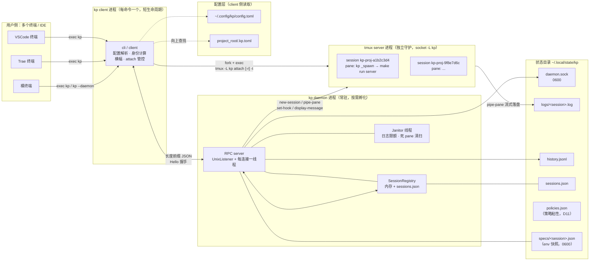
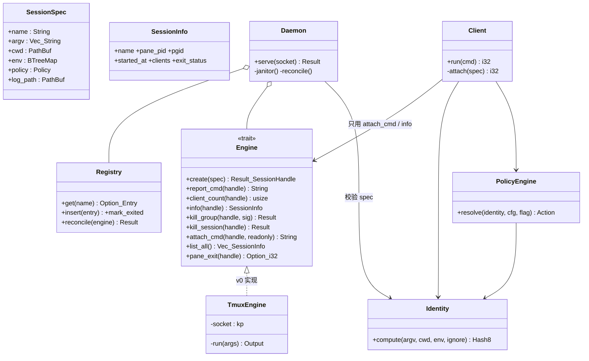
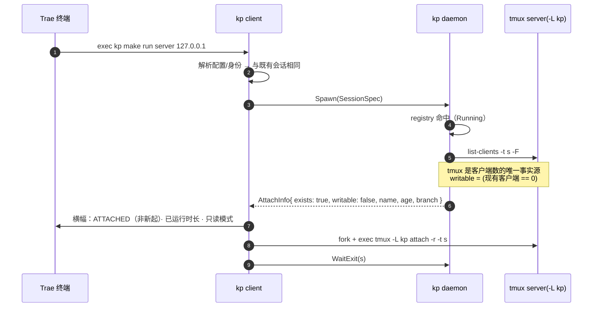
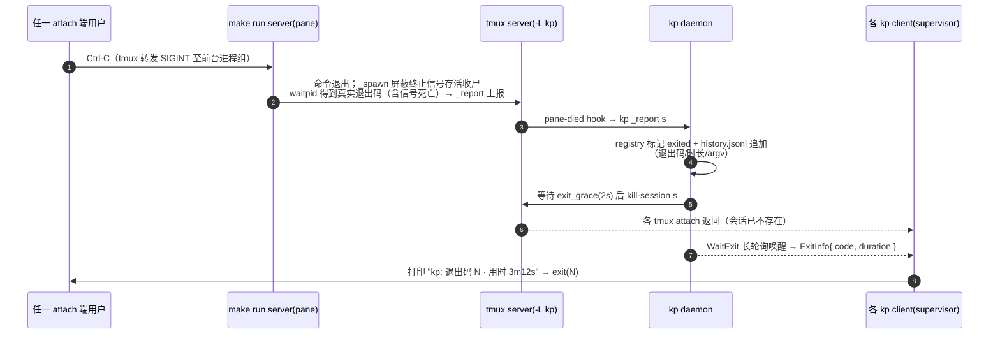
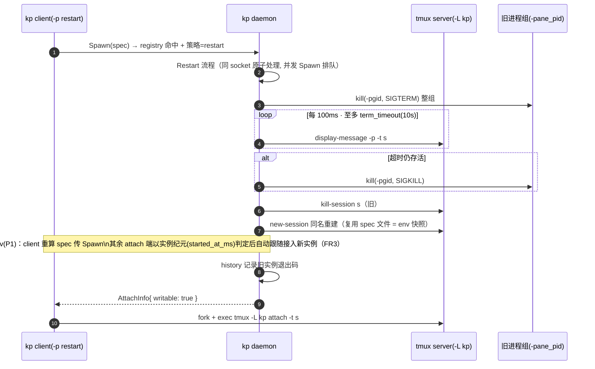
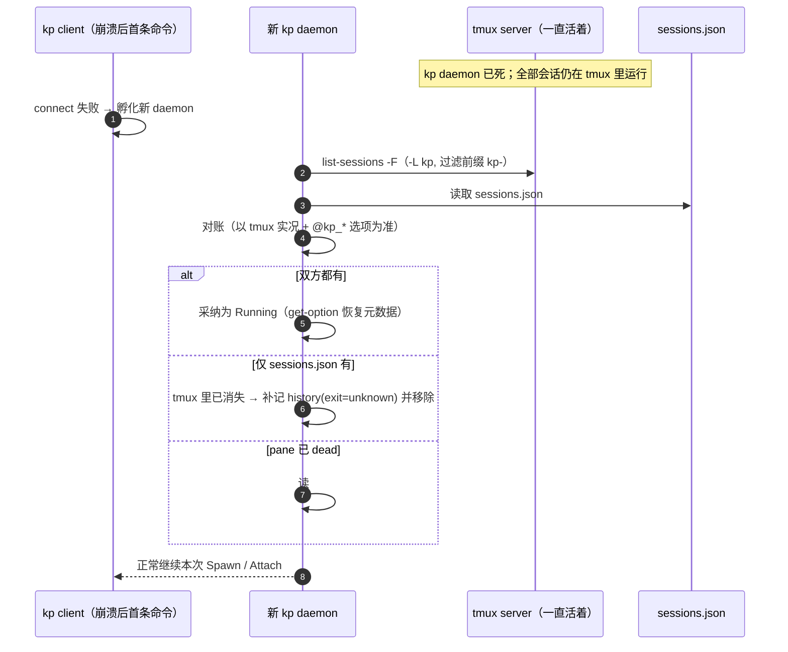
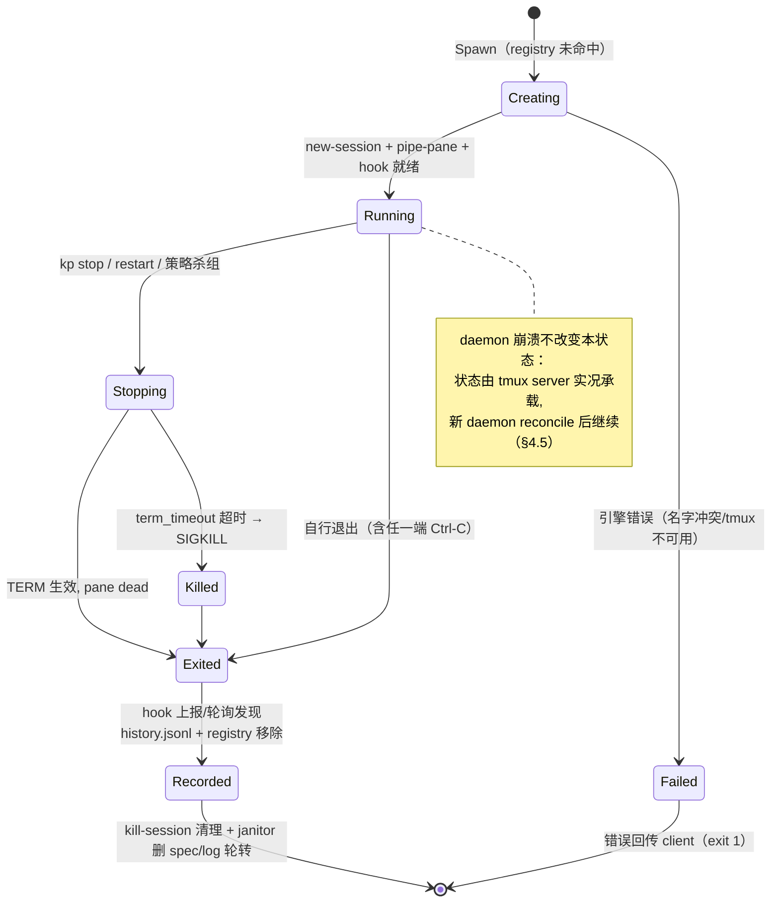

# kp 架构设计（基于 tmux 引擎）

版本：0.1（草案）　日期：2026-11-02
上游：`01-requirements.md`（FR/D 决策）、`04-config.md`（配置）、`02-scope.md`（里程碑）
UML 图以 Mermaid 表述；符号约定：**client** = 短生命周期的 `kp` 前台进程，**daemon** = 常驻 `kp --daemon`，**engine** = `trait Engine` 及其 tmux 实现。

## 1. 总体结构与设计基调

单二进制 `kp`，一个程序三种角色：

1. **client**（每次命令）：解析配置 → 算身份 → 与 daemon 通信 → 前台 attach 或收发指令；`kp` 只做包装（零子命令），管理入口是第二二进制 `kpm`（D10，与 kp 共享本库）；
2. **daemon**（常驻）：唯一持有会话注册表与杀生权的进程；所有变更（spawn/stop/restart）只经它；
3. **engine adapter**：把 daemon 的意图翻译成 tmux 命令，藏在 `trait Engine` 后（screen/自研 PTY 可替换）。

三条全局原则：

- **tmux server 是第四个参与者，也是唯一的 PTY 持有者**。会话进程的父链是 `tmux server → kp _spawn → 实际命令`，而非 kp daemon——这条父子关系决定了全部故障语义（§10）。
- **专用 tmux socket**：所有 tmux 调用一律 `tmux -L kp`，与用户自己的 tmux 完全隔离——会话名永不冲突、kp 不会误杀用户的 tmux、用户 `tmux kill-server` 也伤不到 kp 会话。
- **客户端解析配置、daemon 不读文件**：配置发现/合并/身份计算都在 client 完成（cwd 语境只在 client 正确），daemon 只接收解析后的 `SessionSpec`（见 04-config §2）。

### 1.1 组件图（兼部署视图）



要点：**两条独立通道**——控制流走 daemon RPC，字节流（attach 的终端 I/O）直接走 tmux；daemon 永远不在数据面上。

## 2. 代码结构（单 crate `kp-cli`）

```text
src/
  main.rs            # clap 入口；按子命令分派 client / daemon / 内部命令
  cli.rs             # clap 定义、参数规范化、裸 && 检测
  client/
    mod.rs           # 前台流程编排：config → identity → rpc → attach/管理指令
    attach.rs        # 管控结构：fork tmux attach + WaitExit 轮询（§4.1）
    banner.rs        # attach 横幅
  daemon/
    mod.rs           # accept 循环、线程池
    handlers.rs      # RPC 处理器（Spawn/Attach/Stop/Restart/WaitExit/...）
    incubate.rs      # 自动孵化与单实例锁
    registry.rs      # 注册表（内存 + sessions.json 原子落盘）
    janitor.rs       # 1s tick：死 pane、日志限额、spec 清理
    reconciler.rs    # 启动对账（§4.5）
  engine/
    mod.rs           # trait Engine + SessionSpec / SessionHandle / SessionInfo
    tmux.rs          # tmux 命令封装与 -F 格式解析（一律 -L kp）
  protocol.rs        # RPC 消息（serde Serialize/Deserialize）+ 帧编解码
  identity.rs        # 身份计算（纯函数）
  policy.rs          # 策略决策（纯函数）
  config.rs          # 发现 / 合并 / 校验（04-config 的实现）
  history.rs         # history.jsonl 读写与滚动
  spawn_cmd.rs       # kp _spawn：载入 spec → 应用 env → exec 命令
  paths.rs           # 目录布局与 socket 路径
  glob.rs            # 仅 * 与 ? 的最小 glob
```

## 3. 核心类型与 Engine trait（类图）



`Engine::attach_cmd` 返回的是**命令字符串**（`tmux -L kp attach [-r] -t <name>`），由 client fork+exec 执行——engine 不做 attach 本身（§4.1 说明为何不是 exec 替换）。

## 4. 关键机制与时序图

### 4.1 首次启动：daemon 孵化 + 新建会话

```mermaid
sequenceDiagram
    autonumber
    participant T as 终端 / IDE
    participant C as kp client
    participant D as kp daemon
    participant X as tmux server(-L kp)
    participant P as make run server(pane)

    T->>C: exec kp make run server 127.0.0.1
    C->>C: 发现 .kp.toml → 合并配置<br/>计算身份 hash（env−忽略表, 项目根锚定）
    C->>D: connect daemon.sock
    Note over C,D: 失败 → fork kp --daemon（孵化, 单实例锁）→ 重试
    C->>D: Hello(version)
    D-->>C: Hello(version)
    C->>D: Spawn(SessionSpec)
    D->>D: registry 查询 → 未命中
    D->>D: 写 specs/&lt;name&gt;.json（env 快照, 0600）
    D->>X: new-session -d -s kp-proj-a1b2 -c cwd<br/>"kp _spawn --spec specs/....json"
    X->>P: 创建 pane；_spawn 应用 env 后 fork 命令并 waitpid<br/>pane pid = 进程组 leader
    D->>X: set-option remain-on-exit on<br/>set-hook pane-died "run-shell -b kp _report ..."
    D->>X: pipe-pane -o -t s "cat >> logs/s.log"
    D->>X: set-option @kp_cwd / @kp_branch / @kp_started
    D->>D: registry insert + sessions.json 原子落盘
    D-->>C: AttachInfo{ writable: true, clients: 1 }
    C->>T: 打印横幅（name/pid/branch/clients/提示）
    C->>X: fork + exec tmux -L kp attach -t s
    C->>D: WaitExit(s)（长轮询, 与 attach 并行）
    Note over P,X: 输出经 PTY → pipe-pane 落盘 → attach 回显
```

**为什么 client 是"fork attach + 轮询"而不是 exec 替换**：exec 替换后 client 进程消失，没有任何 kp 代码存活，无法感知会话结束、无法回显退出码、无法以进程退出码退出（FR1）。fork 后 client 变成"supervisor"：子进程跑 tmux attach 承担终端 I/O，自己阻塞在 `WaitExit` 长轮询上，两边谁先返回都能收场（§4.3）。代价是 client 多驻留一个进程（每 attach 会话一个），可接受。

**env 快照经 spec 文件传递**：tmux new-session 经 sh 启动 pane，直接塞几百个环境变量既脏又漏；改为 daemon 把完整 env 写进 `specs/<name>.json`（0600），`_spawn` 读取后**全量替换**自身 environ 再 exec。会话结束时 janitor 删除 spec 文件。

### 4.2 重复命令 → attach（多读单写）



写锁判定不在 registry 里记账，而以 `list-clients` 实时查询 tmux——客户端异常死亡不会留下假锁（tmux 自己回收）。v0 **先到先得、无锁转移**：只读客户端要拿写权需先 `kp stop` 或等全部退出（M2 的 `kp watch` 提供显式只读入口）。

### 4.3 退出传播与 Ctrl-C（FR5 的实现）



关键点：**hook（`kp _report`）保证退出码入账不依赖 daemon 轮询延迟**；`exit_grace` 给 supervisor 们留出收到 WaitExit 响应的时间窗；若 daemon 恰好死了（无人 kill-session），attach 挂在 dead pane 上——reconciler（§4.5）下次启动清理，且 client 的 WaitExit 有 60s 超时兜底：超时后读 `pane_exit`（`#{pane_dead_status}`）自行收场。

### 4.4 restart 策略（FR3/FR6 的实现）



同名重建保持"身份 → 会话名"映射稳定：restart 后第三方再跑原命令仍命中。并发场景（两端同时 `-p restart`）由 daemon 对同名会话的操作加 per-session 锁串行化。

### 4.5 daemon 崩溃与 reconcile（修正后的 D6）



对账方向刻意**以 tmux 为事实源**：sessions.json 只是缓存与元数据补充。副作用是"daemon 崩溃"从原来假设的"全灭"降级为"无感恢复"（需求 D6 已同步修正）。

## 5. 会话状态机



## 6. Engine ↔ tmux 命令映射

所有调用带 `-L kp`；`<s>` = 会话名。

| `trait Engine` 方法 | tmux 调用 / 系统调用 | 说明 |
|---|---|---|
| `create` | `new-session -d -s <s> -c <cwd> "kp _spawn --spec <path>"` | `_spawn` fork+waitpid：pane pid 即进程组 leader；退出码由 waitpid 获得 |
| 观测项设置 | `set-option -t <s> remain-on-exit on`；`set-hook -t <s> pane-died "run-shell -b 'kp _report <s> #{pane_dead_status}'"` | 退出上报（§4.3） |
| `pipe_log` | `pipe-pane -o -t <s> "cat >> <log_path>"` | 原始流含 ANSI 落盘 |
| 元数据 | `set-option -t <s> @kp_cwd/@kp_branch/@kp_started/@kp_identity` | reconcile 与 `kp ls` 的 branch 列 |
| `client_count` | `list-clients -t <s> -F '#{client_name}'` | 多读单写的写锁判定 |
| `info` | `display-message -p -t <s> '#{pane_pid} #{pane_dead} #{pane_dead_status} #{session_created_string} #{session_attached}'` | pid/死活/退出码/年龄/客户端数 |
| `pane_exit` | 同上 `#{pane_dead_status}`（tmux ≥ 3.2） | WaitExit 超时兜底 |
| `kill_group` | 非 tmux：`kill(-pgid, SIGTERM/SIGKILL)`（pgid = pane_pid） | FR6 整组杀 |
| `kill_session` | `kill-session -t <s>` | 附带清理 pipe-pane/hook |
| `list_all` | `list-sessions -F '...'` 前缀过滤 `kp-` | `kp ls` 与 reconcile |
| `attach_cmd` | `attach [-r] -t <s>`（返回命令串，client fork+exec） | 字节流通道 |

tmux < 3.2 时 `pane_dead_status` 不可用 → 退化路径：`_report` 由 hook 以 `#{pane_dead}` 触发但退出码记 unknown；架构不变，`kp doctor` 提示升级。

## 7. RPC 协议

帧格式：`4 字节大端长度 + JSON payload`；连接建立即 `Hello{proto_version}` 双向握手，不匹配则报错指明双方版本。

| 消息 | 方向 | 触发命令 | 语义 | 响应 |
|---|---|---|---|---|
| `Spawn(spec)` | C→D | `kp CMD...` | 注册表命中→按策略分流；未命中→create | `AttachInfo` / `Rejected` / `Queued` |
| `AttachInfo{writable,...}` | D→C | | 是否只读 + 横幅元数据 | — |
| `WaitExit(name, timeout)` | C→D | attach 后 supervisor | 长轮询至会话退出；reason=restart 时跟随新实例继续等 | `ExitInfo{code,duration,reason}` |
| `Stop(name, force)` / `StopAll` | C→D | `kp stop` | 杀组流程（§4.4 前半） | `ExitInfo` |
| `Restart(name)` | C→D | `kp restart` | §4.4 全程 | `AttachInfo` |
| `List` / `Status(name)` | C→D | `kp ls/status` | 读注册表 + engine info | 结构化数据 |
| `ReportDone(name, code, started)` | hook→D | `kp _report` | pane-died 入账（与 WaitExit 唤醒同一把锁） | `ok` |

`wait` 策略 = client 持 `WaitExit` 阻塞到现有会话退出后再走正常 Spawn，无独立消息。

## 8. 并发模型

- **daemon**：std 线程，accept 循环每连接一线程；注册表 `RwLock`；**per-session Mutex** 串行化同会话变更（spawn/restart/stop 互斥）；janitor 单线程 1s tick。无 async 运行时——连接数 = attach 数 + 管理命令，量级为个位数到几十。
- **client**：主线程等两个事件源（`WaitExit` RPC、fork 的 attach 子进程）；SIGINT 处理器在 supervisor 阶段忽略自身死亡（Ctrl-C 属于 pane 的前台组，tmux 负责转发）。
- **原子落盘**：sessions.json 写临时文件 + rename；history.jsonl 单行 append（daemon 内串行化）。

## 9. 安全

| 面 | 措施 |
|---|---|
| daemon.sock | `$XDG_RUNTIME_DIR/kp/`（退回 `$TMPDIR`）目录 0700、socket 0600——本机他用户不可连 |
| specs/*.json | 0600；含 env 快照（可能含密钥），会话结束即删 |
| tmux socket | `-L kp` 独立 socket，位于 daemon.sock 同目录，权限继承 |
| `.kp.toml` | 按不可信输入处理：仅 match/policy/name/cwd 声明，无 hooks/无脚本执行（04-config §6） |
| 注入 | 子进程仅收到 `KP_SESSION_ID`；argv 不经 shell（`_spawn` 直接 exec） |

## 10. 故障模型

| 故障 | 结果 | 恢复 |
|---|---|---|
| 单个 client 崩溃 / 关终端 | 仅 detach；会话不受影响 | 重跑原命令或 `kp attach` 接回 |
| kp daemon 崩溃 | 会话继续跑（tmux 独立） | 新 daemon reconcile（§4.5）；hook 上报失败的退出码补记为 unknown |
| tmux server 被杀 / 崩溃 | 全部会话进程收 SIGHUP 终止（tmux 语义） | registry 对账后移除，history 补记 exit=SIGHUP；**语义与自研 PTY 时一致，接受** |
| daemon 与 client 版本不匹配 | Hello 握手失败 | 提示升级命令后退出（exit 4） |
| 日志写满上限 | janitor 截断/轮转 | 无数据丢失面（日志非权威记录） |
| socket 目录被清（重启机器） | daemon 自启动即全新 | 会话本就随机器重启消失（与 screen/tmux 一致） |
| 磁盘只读 / 状态目录不可写 | spawn 失败报错 | exit 1 + 指明路径 |

## 11. 性能预算（attach 冷启动 < 100ms）

| 阶段 | 预算 |
|---|---|
| 配置发现+合并+身份 hash | < 2ms（单次向上目录扫描 + sha256） |
| daemon 孵化（仅首次） | ~10ms（fork+exec 自身） |
| RPC 往返 ×2（Hello+Spawn/AttachInfo） | < 2ms |
| engine create（tmux new-session 本地） | 20–50ms |
| fork+exec tmux attach | < 10ms |

管理命令（ls/stop）不经 tmux 引擎路径时 < 10ms。预算超标的第一嫌疑人是 `list-clients`/`display-message` 的进程 fork 开销——必要时合并为单次 `list-sessions -F` 批量取回。

## 12. 架构级决策记录

| # | 决策 | 理由 |
|---|---|---|
| A1 | 专用 tmux socket（`-L kp`） | 与用户 tmux 双向隔离；也是 daemon 崩溃后会话存活的根基 |
| A2 | env 走 spec 文件而非命令行/tmux set-environment | 几百个变量经 sh 传参脏且漏；文件可 0600、可复用于 restart |
| A3 | client = fork attach + WaitExit 轮询的 supervisor | exec 替换会丢失感知退出码的能力（FR1 硬需求） |
| A4 | 客户端数以 tmux `list-clients` 为事实源 | 异常客户端不留假锁；registry 不记账 |
| A5 | `_spawn` fork+waitpid 主动上报退出码，pane-died hook 兜底 | tmux `#{pane_dead_status}` 对信号死亡返回空；Ctrl-C（FR5 主路径）的 130 只有 waitpid 拿得到；`_spawn` 屏蔽终止信号以存活收尸，子进程经 pre_exec 恢复默认处置 |
| A6 | reconcile 以 tmux 实况为准 | 注册表只是缓存——崩溃恢复方向单一，无"谁是真相"之争 |
| A7 | per-session 锁而非全局锁 | stop/restart 慢操作不阻塞其他会话的 spawn |
| A8 | `kp _report` 复用主 RPC 通道 | 一个协议一套握手，不为 hook 单开旁路 |
